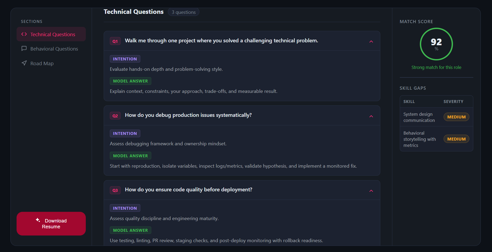
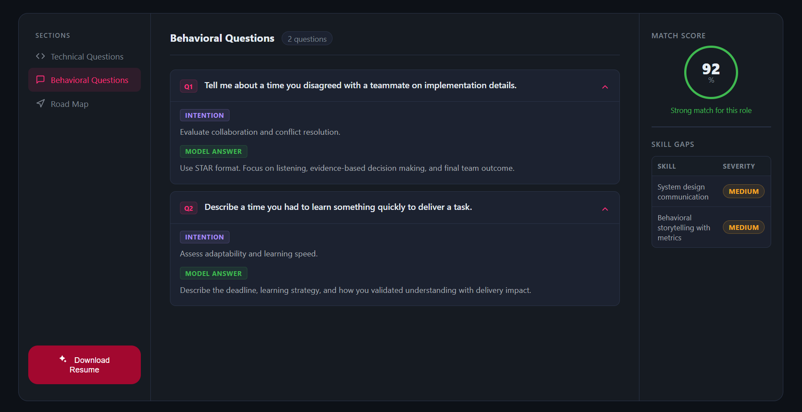
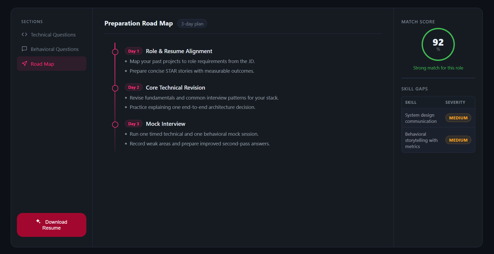

# 🎯 AI-Powered Interview Intelligence & Resume Optimizer (Client)

> **Backend API Repository:** [Link to Backend Repo](https://github.com/muskanmaurya/Full-Stack-Gen-AI-Job-Preparation-Web-Application-Backend)  
> **Live Demo:** [https://full-stack-gen-ai-job-preparation-w.vercel.app](https://full-stack-gen-ai-job-preparation-w.vercel.app)

---

## 📸 Platform Overview







An end-to-end, AI-driven job preparation platform designed to bridge candidate skill gaps and automate interview readiness. The application analyzes user profiles against target job descriptions using Generative AI to generate personalized preparation roadmaps, targeted questions, and ATS-friendly PDF resumes.

---

## 🚀 Key Features

* **⚡ Interactive Dashboard:** Implemented a modern, responsive UI built with React, Vite, and SCSS/Tailwind CSS featuring custom dark mode aesthetics and tabbed sections.
* **🤖 AI Strategy Generation:** Interfaces with Gemini AI to produce job-to-resume match scores, tailored technical/behavioral questions, and structured day-wise preparation roadmaps.
* **🛡️ Session & Auth State Management:** Integrated React Context API (`AuthProvider` and `InterviewProvider`) supporting both guest-session states and authenticated user dashboards with JWT handling.
* **📄 Dynamic PDF Download:** Triggers server-side PDF generation via Puppeteer and downloads ATS-compliant tailored resumes directly from the client UI.

---

## 🏗️ Architecture & Data Flow

```text
[ User Input (PDF / Text) ]
       │
       ▼
[ React Frontend (Vercel) ] ──(Multipart Form Data / Axios)──► [ Express Backend (Render) ]
       │
       ┌────────────────────────┴────────────────────────┐
       ▼                                                 ▼
[ Gemini 2.5 API Service ]                       [ Puppeteer PDF Compiler ]
(Structured Output Engine)                       (Tailored Resume Generation)
       │                                                 │
       └────────────────────────┬────────────────────────┘
                                ▼
[ Dynamic Interview UI ] ◄──────(JSON Intelligence Payload)───────────┘
```

1. **Input Capture:** The client captures user self-descriptions, target JDs, and multipart PDF resume uploads via custom file hooks (`useInterview`).
2. **API Communication:** Requests are dispatched via Axios with credentials to the Node.js/Express backend hosted on Render.
3. **State Hydration:** Returned AI reports are sanitized, normalized across edge cases, and hydrated into application context for dynamic tab rendering (Technical, Behavioral, and Roadmap views).

---

## 🛠️ Frontend Tech Stack

* **Core Framework:** React 19, Vite
* **Routing:** React Router v7
* **State Management:** React Context API + Custom Hooks (`useAuth`, `useInterview`)
* **Styling:** SCSS, Tailwind CSS
* **HTTP Client:** Axios with Request Interceptors & Guest Token handling
* **Deployment:** Vercel

---

## 🔧 Local Development Setup

### 1. Clone the Repository
```bash
git clone https://github.com/muskanmaurya/-Full-Stack-Gen-AI-Job-Preparation-Web-Application-Frontend.git
cd -Full-Stack-Gen-AI-Job-Preparation-Web-Application-Frontend
```

### 2. Install Dependencies
```bash
npm install
```

### 3. Configure Environment Variables
Create a `.env` file in the root directory of the project:
```env
VITE_API_BASE_URL=http://localhost:5000
```

### 4. Run the Development Server
```bash
npm run dev
```

The application will be available locally at `http://localhost:5173`.
